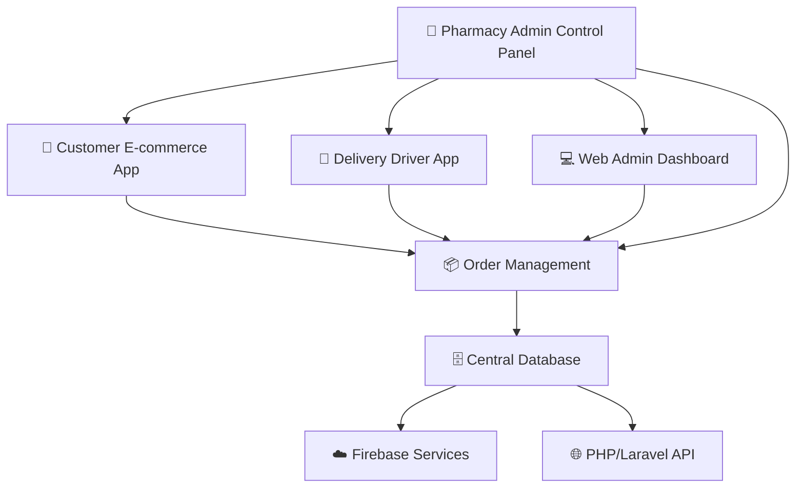

# 🏥 Pharmacy Admin Control Panel

<div align="center">


**A comprehensive pharmacy management system built with Flutter**

[](https://github.com/oiu85)
[](https://github.com/oiu85)
[](https://github.com/oiu85/pharmacy-admin-control-panel/issues)
[](https://github.com/oiu85/pharmacy-admin-control-panel)

</div>

---

## 📱 Project Overview

This is the **Admin Control Panel** for a comprehensive pharmacy management ecosystem consisting of three interconnected applications:

### 🏗️ Complete System Architecture



---

## ✨ Features

### 🔐 Authentication & Security
- **Secure Login System** with Firebase Authentication
- **Multi-language Support** (Arabic & English)
- **Role-based Access Control**
- **OTP Verification** for account security
- **Password Reset** functionality

### 📊 Dashboard & Analytics
- **Real-time Statistics** and KPIs
- **Interactive Charts** and Reports
- **Sales Analytics** (Daily/Weekly/Monthly)
- **User Activity Monitoring**
- **Order Status Tracking**

### 🏪 Inventory Management
- **Product Management** (Add, Edit, Delete)
- **Category & Subcategory** Organization
- **Stock Level Monitoring**
- **Image Upload** for products
- **Prescription Requirements** tracking

### 👥 User Management
- **Customer Management** with approval system
- **Delivery Driver** registration and management
- **User Activity** monitoring
- **Account Status** control

### 📦 Order Management
- **Order Processing** workflow
- **Status Updates** (Pending → Accepted → Preparing → Delivered)
- **Order Details** with Google Maps integration
- **Order History** and archiving
- **Real-time Notifications**

### 🎟️ Marketing & Promotions
- **Coupon System** with expiration dates
- **Discount Management**
- **Promotional Campaigns**
- **Usage Analytics**

### ⚙️ System Settings
- **App Configuration** management
- **Notification Settings**
- **Language Preferences**
- **Theme Customization**

---

## 🛠️ Technology Stack

### Frontend
- **Flutter** 3.7.2+ with Dart
- **GetX** for state management and navigation
- **Material Design 3** with custom theming
- **Responsive Design** for multiple screen sizes

### Backend & Services
- **Firebase** for authentication and notifications
- **PHP/Laravel** API for data management
- **MySQL** database
- **RESTful API** architecture

### Key Dependencies
```yaml
# State Management
get: ^4.6.6

# UI & Animation
lottie: ^3.2.0
show_up_animation: ^2.0.0
auto_animated: ^3.0.1

# Maps & Location
google_maps_flutter: ^2.12.1
geolocator: ^13.0.2

# Firebase
firebase_core: any
firebase_messaging: ^15.1.6
cloud_firestore: ^5.6.0

# Charts & Analytics
fl_chart: ^1.0.0

# Image Handling
cached_network_image: ^3.2.0
image_picker: ^1.1.2

# Local Storage
shared_preferences: ^2.0.15
sqflite: ^2.0.2
```

---

## 📱 Screenshots

<div align="center">

### 🔐 Authentication
 

### 📊 Dashboard
 

### 🏪 Management
 

</div>

---

## 🚀 Getting Started

### Prerequisites
- Flutter SDK 3.7.2 or higher
- Dart SDK 3.0.0 or higher
- Android Studio / VS Code
- Firebase project setup
- PHP/Laravel backend running

### Installation

1. **Clone the repository**
   ```bash
   git clone https://github.com/oiu85/pharmacy-admin-control-panel.git
   cd pharmacy-admin-control-panel
   ```

2. **Install dependencies**
   ```bash
   flutter pub get
   ```

3. **Configure Firebase**
   - Add your `google-services.json` (Android) and `GoogleService-Info.plist` (iOS)
   - Update Firebase configuration in `lib/core/services/services.dart`

4. **Configure API endpoints**
   - Update API base URL in `lib/linkapi.dart`
   - Configure authentication headers

5. **Run the application**
   ```bash
   flutter run
   ```

### Build for Production

**Android APK:**
```bash
flutter build apk --release
```

**iOS:**
```bash
flutter build ios --release
```

**Web:**
```bash
flutter build web --release
```

---

## 🏗️ Project Structure

```
lib/
├── 📁 binding/                 # Dependency injection bindings
├── 📁 controller/              # GetX controllers (Business Logic)
│   ├── 📁 auth/               # Authentication controllers
│   ├── 📁 categories/         # Category management
│   ├── 📁 items/              # Product management
│   ├── 📁 orders/             # Order management
│   ├── 📁 admin_users/        # User management
│   └── 📁 admin_delivery/     # Delivery management
├── 📁 core/                   # Core utilities and services
│   ├── 📁 class/              # Base classes and models
│   ├── 📁 constant/           # App constants and themes
│   ├── 📁 functions/          # Utility functions
│   ├── 📁 services/           # Firebase and API services
│   └── 📁 shared/             # Shared widgets
├── 📁 data/                   # Data layer
│   ├── 📁 datasource/         # API and local data sources
│   └── 📁 model/              # Data models
└── 📁 view/                   # UI layer
    ├── 📁 screen/             # App screens
    ├── 📁 widget/             # Reusable widgets
    └── 📁 orders/             # Order-related screens
```

---

## 🔧 Configuration

### Environment Variables
Create a `.env` file in the root directory:

```env
# API Configuration
API_BASE_URL=https://your-api-domain.com/api/
API_KEY=your_api_key_here

# Firebase Configuration
FIREBASE_PROJECT_ID=your_project_id
FIREBASE_MESSAGING_SENDER_ID=your_sender_id

# Google Maps
GOOGLE_MAPS_API_KEY=your_google_maps_key
```

### Multi-language Support
The app supports Arabic and English. Language files are located in:
- `lib/core/localization/translation.dart`

---

## 📊 API Integration

### Authentication Endpoints
- `POST /auth/login` - User login
- `POST /auth/register` - User registration
- `POST /auth/verify-otp` - OTP verification
- `POST /auth/reset-password` - Password reset

### Management Endpoints
- `GET /admin/products` - Get all products
- `POST /admin/products` - Create product
- `PUT /admin/products/{id}` - Update product
- `DELETE /admin/products/{id}` - Delete product

### Order Endpoints
- `GET /admin/orders` - Get all orders
- `PUT /admin/orders/{id}/status` - Update order status
- `GET /admin/orders/{id}/details` - Get order details

---

## 🧪 Testing

Run tests with:
```bash
# Unit tests
flutter test

# Integration tests
flutter test integration_test/
```

---

## 📈 Performance Optimizations

- **Lazy Loading** for large lists
- **Image Caching** with `cached_network_image`
- **State Management** optimization with GetX
- **Memory Management** for large datasets
- **Network Optimization** with proper API calls

---

## 🔒 Security Features

- **Input Validation** on all forms
- **SQL Injection** prevention
- **XSS Protection** in web views
- **Secure API** communication
- **Role-based Access** control
- **Data Encryption** for sensitive information

---

## 🌐 Related Projects

### 📱 Customer E-commerce App
- **Repository**: [Ecommerce-flutter-app-Pharmacy](https://github.com/oiu85/Ecommerce-flutter-app-Pharmacy)
- **Features**: Product browsing, cart management, order placement
- **Technologies**: Flutter, Firebase, Payment integration

### 🚚 Delivery Driver App
- **Repository**: [Ecommerce-Delivery-flutter-app](https://github.com/oiu85/Ecommerce-Delivery-flutter-app)
- **Features**: Order pickup, delivery tracking, route optimization
- **Technologies**: Flutter, Google Maps, GPS tracking

### 💻 Web Admin Dashboard
- **Features**: Advanced analytics, bulk operations, system monitoring
- **Technologies**: React.js, Node.js, Chart.js

---

## 🤝 Contributing

We welcome contributions! Please follow these steps:

1. **Fork** the repository
2. **Create** a feature branch (`git checkout -b feature/AmazingFeature`)
3. **Commit** your changes (`git commit -m 'Add some AmazingFeature'`)
4. **Push** to the branch (`git push origin feature/AmazingFeature`)
5. **Open** a Pull Request

### Development Guidelines
- Follow Flutter/Dart style guidelines
- Write comprehensive tests
- Update documentation
- Ensure all tests pass

---

## 📝 License

This project is licensed under the MIT License - see the [LICENSE](LICENSE) file for details.

---

## 👨‍💻 Author

**Abdullah Alatrash**
- **GitHub**: [@oiu85](https://github.com/oiu85)
- **GitLab**: [@love14144.mn](https://gitlab.com/love14144.mn)
- **LinkedIn**: [Abdullah Alatrash](https://www.linkedin.com/in/abdullah-alatrash)
- **Email**: abdullah.alatrash.dev@gmail.com

### 🏆 Experience
- **2+ years** Flutter development
- **Firebase** integration specialist
- **PHP/Laravel** backend development
- **Real-time Database** expert
- **E-commerce** solutions architect

---

## 🙏 Acknowledgments

- **Flutter Team** for the amazing framework
- **GetX** for state management
- **Firebase** for backend services
- **Open Source Community** for inspiration
- **Contributors** who helped improve this project

---

## 📞 Support

If you have any questions or need help:

- **Create an issue** on GitHub
- **Contact me** via email
- **Check the documentation** in the `/docs` folder
- **Join our community** discussions

---

<div align="center">

### ⭐ Star this repository if you found it helpful!

**Made with ❤️ by [Abdullah Alatrash](https://github.com/oiu85)**

[](https://github.com/oiu85)
[](https://twitter.com/oiu85)

</div>